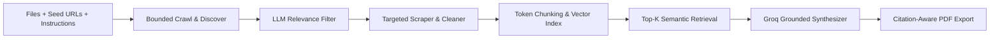

# 🔬 ResearchLens — RAG Research Paper Summarization Tool

ResearchLens is a high-performance Retrieval-Augmented Generation (RAG) system that integrates uploaded research documents (PDF, DOCX, TXT, CSV, XLSX) with bounded, LLM-filtered web evidence to generate grounded, citation-aware research reports.

---

## 📋 System Architecture & Workflow



1. **Multi-Source Research Material Ingestion**:
   - Parses multi-format research literature: **PDF** (PyMuPDF/fitz with page preservation), **DOCX** (sections and headings), and **TXT**.
   - Accepts supplementary data: **CSV** and **XLSX** (tabular data chunks, sheet names, row ranges).
   - Preserves all source metadata: `filename`, `page`, `section`, `sheet`, `title`, and `URL`.

2. **Bounded Web Scraping Agent (Python State Machine)**:
   - Starts **strictly** from user-supplied starting URLs (no unrestricted search).
   - Enforces configurable depth limits (default: 1–2) and page count limits (default: 10–20).
   - Restricts crawling to the seed URL domain (configurable).
   - Deduplicates URLs, strips tracking tags/fragments, and checks `robots.txt`.
   - **Discovery Phase**: Shallow-crawls candidate links, titles, snippets, and anchor texts *before* full extraction.

3. **LLM Relevance Filter (Groq API Structured Output)**:
   - Evaluates discovered candidate pages against the research topic and user document instructions.
   - Outputs structured scores (0.0 to 10.0), acceptance/rejection decisions, and explicit justifications.
   - Only approved candidate pages proceed to full content extraction.

4. **Targeted Extraction & Content Normalization**:
   - Primary: Fast extraction via `Requests` and `BeautifulSoup4`.
   - Cleans boilerplate (scripts, ads, navigation bars, cookie banners) and extracts structured headings and tables.
   - Detects JavaScript-rendered SPAs (e.g. empty root divs with noscript tags) and provides rendering fallback.

5. **Token Chunking & Semantic Vector Retrieval**:
   - Chunks text into windows of ~500–800 tokens with 10–20% overlap.
   - Embeddings: Sentence-Transformers (`all-MiniLM-L6-v2`) with robust cosine fallback.
   - Vector Store: FAISS index / NumPy cosine similarity engine.
   - Top-K Semantic Retrieval: Returns top-5 chunks by default, exposing similarity scores and source provenance for inspection.

6. **Grounded Synthesis & Report Generation (Groq API)**:
   - Synthesizes findings using Groq instruction models (`llama-3.3-70b-versatile` or `llama-3.1-8b-instant`).
   - Adheres strictly to user instructions: purpose, focus, required sections, academic tone, and format.
   - Synthesizes comparative matrices (`Comparison Table`) and explicitly enumerates `Research Gaps`.
   - Enforces strict grounding and citation markers (`[1]`, `[2]`, etc.).

7. **Publication-Ready PDF Export (ReportLab)**:
   - Dynamic `NumberedCanvas` generating "Page X of Y" running headers and footers.
   - Formatted Executive Summary, Structured Synthesis Sections, Comparative Matrix Table, and Numbered Citation Bibliography.
   - Guaranteed citation awareness: every claim cites the originating file and page or exact crawled URL.

---

## 🚀 Quickstart Guide

### 1. Prerequisites
- Python 3.10+ (tested on Python 3.13)
- (Optional) Groq API Key from [console.groq.com](https://console.groq.com)

### 2. Setup Virtual Environment
```bash
# Create virtual environment
python -m venv venv

# Activate on Windows PowerShell:
.\venv\Scripts\Activate.ps1

# Activate on Linux/macOS:
source venv/bin/activate
```

### 3. Install Dependencies
```bash
pip install -r requirements.txt
```

### 4. Configuration (.env)
Copy `.env.example` to `.env` and set your credentials:
```bash
cp .env.example .env
```
Inside `.env`:
```ini
GROQ_API_KEY=your_groq_api_key_here
GROQ_MODEL=llama-3.3-70b-versatile
GROQ_FILTER_MODEL=llama-3.1-8b-instant
DEFAULT_CRAWL_DEPTH=1
DEFAULT_MAX_PAGES=15
CHUNK_SIZE=600
CHUNK_OVERLAP=100
TOP_K_RETRIEVAL=5
```
*(Note: ResearchLens reads your Groq API Key exclusively from the `.env` configuration file.)*

### 5. Launch the Application
```bash
streamlit run app.py
```
Open your browser at `http://localhost:8501`.

---

## 🧪 Running Unit & Integration Tests

Run the test suite using Python's built-in `unittest`:
```bash
python -m unittest discover tests -v
```

Included test suites:
- `tests/test_chunker.py`: Verifies token chunk sizes, overlap, and source metadata retention.
- `tests/test_crawler.py`: Verifies state machine transitions, URL normalization, and deduplication.
- `tests/test_extractor.py`: Verifies HTML normalization, boilerplate stripping, and JS SPA detection.
- `tests/test_filter.py`: Verifies LLM relevance filter scoring, thresholding, and rejection reasons.
- `tests/test_rag.py`: Verifies vector embeddings, index creation, and top-k semantic retrieval with scores.
- `tests/test_pdf.py`: Verifies ReportLab citation-aware PDF generation and table rendering.
- `tests/test_parsers.py`: Verifies multi-format parsing for TXT, CSV, DOCX, and PDF.
- `tests/test_end_to_end.py`: End-to-end integration test of the complete multi-source pipeline.

---

## 🎛️ Crawler & Filter Controls Reference

| Control | Default | Description |
| :--- | :--- | :--- |
| **Max Crawl Depth** | `1` | Number of link hops away from the seed URL (Depth 0 = seed URL only, Depth 1 = seed + immediate links). |
| **Max Discovered Pages** | `12` | Upper bound on discovered candidate links per session to ensure fast, bounded crawling. |
| **Strict Same Domain** | `Enabled` | Restricts crawling strictly to the website domain of the seed URL (e.g. `arxiv.org` only), ignoring third-party external links. |
| **LLM Filter Threshold** | `6.0` | Minimum score (0.0 to 10.0) for a discovered candidate page to be extracted into the RAG pipeline. Pages below this threshold are rejected with explicit reasons. |

---

## 📁 Repository Structure

```
Research_Lens/
├── venv/                       # Virtual environment (ignored by git)
├── .gitignore                  # Git ignore rules (.env, venv, cache, etc.)
├── .env.example                # Template configuration file
├── .env                        # Local environment configuration
├── requirements.txt            # Python dependencies
├── README.md                   # System documentation & quickstart
├── app.py                      # Interactive Streamlit application
├── data/
│   └── samples/                # Sample papers and benchmark datasets
│       ├── rag_modular_survey.txt
│       └── rag_benchmarks.csv
├── src/
│   ├── config.py               # Central configuration & directory setup
│   ├── models/
│   │   └── schemas.py          # Pydantic schemas (Chunks, Pages, Decisions, Reports)
│   ├── parsers/
│   │   └── document_parser.py  # Multi-format parser (PDF, DOCX, TXT, CSV, XLSX)
│   ├── scraper/
│   │   ├── state_machine.py    # Crawl state machine (DISCOVERING -> FILTERING -> EXTRACTING)
│   │   ├── crawler.py          # Bounded crawler (domain-bound, depth, deduplication)
│   │   └── extractor.py        # Requests + BeautifulSoup and JS fallback extractor
│   ├── filter/
│   │   └── relevance_filter.py # Groq structured LLM filter with rejection reasons
│   ├── rag/
│   │   ├── chunker.py          # ~500-800 token chunker with 10-20% overlap & metadata
│   │   ├── embeddings.py       # Sentence-Transformers (all-MiniLM-L6-v2) & vector engine
│   │   └── vector_store.py     # FAISS / Cosine vector store & top-k retrieval
│   ├── synthesizer/
│   │   └── groq_synthesizer.py # Grounded synthesis report generator & citations
│   └── exporter/
│       └── pdf_generator.py    # ReportLab publication-ready citation PDF generator
└── tests/
    ├── test_parsers.py
    ├── test_chunker.py
    ├── test_crawler.py
    ├── test_extractor.py
    ├── test_filter.py
    ├── test_rag.py
    ├── test_pdf.py
    └── test_end_to_end.py
```
